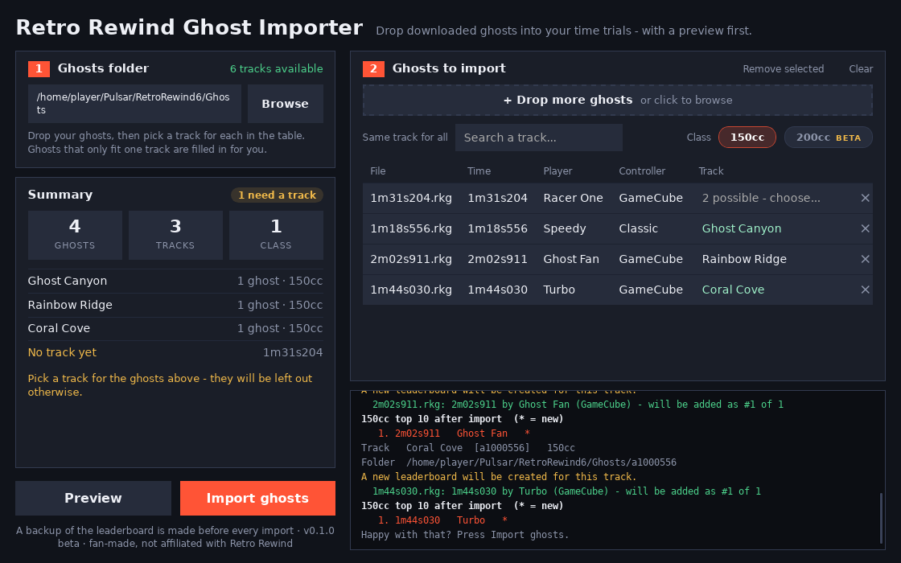

# Retro Rewind Ghost Importer

Add downloaded `.rkg` ghost files to **Retro Rewind v6** (Pulsar) time trials - drag them in, pick the track,
preview, import. No hand-editing of game files.



> **Beta, fan-made, unofficial.** Not affiliated with Retro Rewind, Wheel Wizard or Nintendo. It was built with AI
> assistance and tested on one setup (Windows + Wheel Wizard + Retro Rewind v6). It edits files in your game folder -
> it makes a backup first, but please keep your own copy of the `Ghosts` folder too.

## Why this exists

Retro Rewind saves the ghosts you set as files in its own `Ghosts` folder: one folder per track, a `ldb.pul`
leaderboard, and the ghost files named by finish time. In my testing, importing a ghost with a save-file tool
(Ghost Manager) didn't make it appear in Retro Rewind, and dropping a `.rkg` into a track folder on its own didn't
either - the game lists ghosts from the leaderboard. So this tool writes both parts the way the game does. (I can't
rule out other routes; this is just what worked.) The format notes are in
[`docs/ldb-pul-format.md`](docs/ldb-pul-format.md), in case they help someone else (or Wheel Wizard itself).

## Features

- Drag and drop `.rkg` files; see time, player and controller for each, and pick the track right in the list
- **Preview** shows exactly what would happen (and the resulting top 10) before anything is written
- **Auto-detect** narrows each ghost to the few tracks it could belong to - and picks it for you when only one fits
- Handles tracks that have a second version (e.g. the numbered `1` folder)
- Creates the track folder / leaderboard if the game hasn't yet
- 150cc, and an **experimental** 200cc option
- A backup of each `ldb.pul` is made before it is changed; duplicates are skipped

## Install and run

You need [Python 3.8+](https://www.python.org/downloads/). Nothing else.

```
python rr_ghost_importer.py
```

- Double-click `launch.pyw` to run without a console window.
- For a real app window instead of an Edge/Chrome one: `pip install pywebview` (uses the WebView2 component that
  ships with Windows 10/11).
- Build an exe: run `build_exe.bat` (needs `pip`; produces `dist\RRGhostImporter.exe`).
- Options: `--ghosts-dir PATH`, `--no-window` (prints the local address), `--port N`, `--version`.

## Using it

1. **Close the game** (and your emulator, if you use one).
2. The Ghosts folder (`...\Pulsar\RetroRewind6\Ghosts`) is found automatically; use *Browse* if it isn't.
3. Drop your `.rkg` files in. Each ghost gets a **Track** cell: if it only fits one track it is filled in, otherwise
   choose from the shortlist or search by name. A track that isn't listed can be entered by typing its 8-character ID
   (add `/1` for a second version). Importing several ghosts for one track? Use **Same track for all**.
4. Choose 150cc (and/or 200cc), press **Preview**, then **Import ghosts**.
5. Start the game, open Time Trials on that track.

**Undo:** each change leaves `ldb.pul.backup-<date>` next to the leaderboard. Delete the new `ldb.pul` and rename the
backup back. Ghost files the tool added are in the `150` / `200` folders and can simply be deleted.

## Limits - please read

- **150cc is verified** against files the game wrote. **200cc is a guess** at where the table sits (it refuses to
  write if the area doesn't look right) - treat it as experimental and tell me what you see.
- **Auto-detect is a shortlist, not a guarantee.** A ghost doesn't say which track it is from, only a stock-game slot
  number, and several tracks share each one. It needs the pack's `ExpertsRT` folder and track list, which are found on
  a normal install.
- A ghost recorded on a different Retro Rewind version of a track may desync or not load.
- Tested on one setup only (Windows, Wheel Wizard, Retro Rewind v6). It works on the files the game writes, so how you launch the game shouldn't matter, but that is untested.
- Windows tested only. The leaderboard/folder logic is plain Python and should work elsewhere; the window launcher
  and title-bar tweaks are Windows-specific.

## Safety

- The app only talks to your own computer (`127.0.0.1`, random port, with a per-run token).
- It only writes inside the Ghosts folder you pick: `ldb.pul` files and the ghost files in `150` / `200`.
- It doesn't touch your save file or change trophy values. It only edits the leaderboard files (`ldb.pul`) and adds ghost files in the Ghosts folder.

## Development

```
python -m unittest discover -s tests
```

Tests use synthetic ghosts - no game files are needed or included. Please don't commit your own ghosts, saves or
`ldb.pul` files.

## Credits

Built by observing the files Retro Rewind itself writes. Thanks to the Retro Rewind and Wheel Wizard teams for the
games and tools this sits beside. The track list is read from your own install and is not redistributed here.

## Licence

MIT - see [LICENSE](LICENSE).
